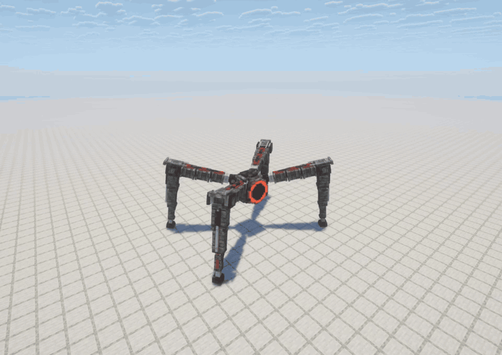

# Minecraft Machines

A Minecraft mod that adds an enemy inspired by the Leaper from ARC Raiders.
It walks and jumps using Sable physics, patrols its surroundings, investigates
sounds and hunts players it spots.

[](docs/media/leaper-movement.mp4)

[Movement](docs/media/leaper-movement.mp4) · [Attack](docs/media/leaper-attack.mp4)

Its charged shockwave throws players and breaks nearby blocks.

## Try it

For Minecraft 1.21.1 with NeoForge 21.1.228 or newer.
Put the Minecraft Machines JAR and Sable 2.0.1 in your instance's `mods` folder.

To run from source, use Java 21:

```sh
git clone --recursive https://github.com/AhHamedi/MinecraftMachines.git
cd MinecraftMachines
tools/run-client.sh --leaper
```

Enable cheats in your world, then use:

| Command | Action |
| --- | --- |
| `/mm leaper spawn` | Spawn a Leaper that patrols the area. |
| `/mm leaper hunt` | Start hunting you. |
| `/mm leaper stick` | Get the targeting stick. |
| `/mm leaper stop` | Stop movement and hunting. |
| `/mm leaper remove` | Remove the Leaper. |
| `/mm leaper scale 1.5` | Make it larger; use `scale 1` to restore its size. |

Right-click the top of a block with the stick to choose a destination.
Right-click empty air to start a hunt; Shift-right-click stops movement.

Leapers are currently spawned through commands and removed when their owner
disconnects. Attacks damage terrain, and an attack already charging still fires
after Stop.

## Development

Build with `./gradlew :minecraft_machines:leaper:build`.
The JAR is written to `minecraft_machines/leaper/build/libs/`.
See [CONTRIBUTING.md](CONTRIBUTING.md) for tests and development setup.

Original code and assets by Ahmed Hamed, licensed under [MIT](LICENSE.md).
Dependencies retain their own licenses; see [THIRD_PARTY_NOTICES.md](THIRD_PARTY_NOTICES.md).
