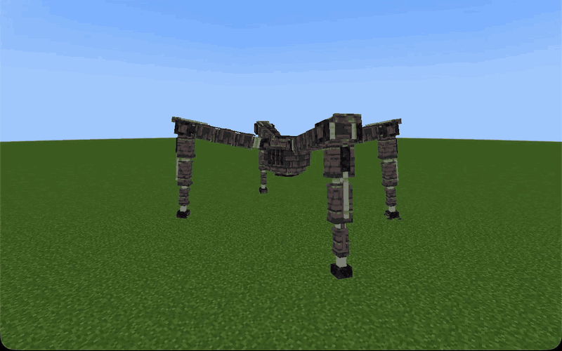

# Minecraft Machines

[](https://github.com/AhHamedi/MinecraftMachines/actions/workflows/ci.yml)
[](LICENSE.md)

An experimental Minecraft 1.21.1 / NeoForge add-on for physically simulated machines. Current development centres on the **Leaper**: an articulated hostile machine with terrain-aware movement, perception, hunting and a concussive attack, built on Sable physics.



[Watch Apex movement](docs/media/leaper-apex-gameplay.mp4) · [Watch the concussive attack](docs/media/leaper-shockwave-vanilla.mp4)

These September 2026 recordings show native gameplay at normal timing. The GIF is an eight-second, reduced-resolution attack excerpt. The clips predate later gameplay changes, including blast range and terrain destruction; fresh source verification is recorded separately. [Media and evidence provenance](docs/evidence/README.md).

## The current Leaper

- **Physical articulation:** 13 rigid bodies and 12 limited motor joints, with original Minecraft-style cuboid meshes and collision geometry.
- **Apex movement:** continuous terrain-conditioned stepping, assisted traction, braking and steering; walking routes, collision-checked ballistic leaps, partial-footing recovery and escape replanning.
- **Awareness:** blue-eyed patrol, orange investigation and red hunting. Sight accounts for obstruction, light, crouching and invisibility; footsteps provide bounded clues. Lost targets lead to a finite last-seen search and a return home.
- **Concussive attack:** a three-second charge, gold-white trails, pressure burst, debris, original sound effects and player launch. The same burst can destroy nearby obstructions when the machine becomes trapped.
- **Physical sizes and paces:** 1×, 1.5× and 2× bodies; Careful, Standard, Horrific and Super Horrific pace controls. Scaling rebuilds meshes, colliders, joints and terrain clearance.

Apex is the current gameplay controller. Earlier Classic, flat-ground and terrain revisions remain documented as engineering history. Read the [Leaper overview](docs/leaper.md), [controls](docs/leaper-controls.md), [behaviour](docs/leaper-behaviour.md), [attack](docs/leaper-shockwave.md) and [scaling](docs/leaper-scaling.md).

The repository also retains the trained eight-joint quadruped, the earlier two-servo Duopod, bounded robotic servo blocks, Java cross-entropy training and a loopback Python Gymnasium / Stable-Baselines3 bridge. The Leaper uses evolved controller parameters and engineered planning; the Python PPO tooling is a separate Duopod experiment.

## Development status

This is a source-first development project with no supported binary release. Commands, controllers, assets and training contracts may change. Leapers are currently command-spawned and player-owned; complete rigs are removed when their owner disconnects or the server stops rather than saved as persistent world mobs.

Terrain still needs room for the full physical stance. Dense foliage, narrow passages, water, landing rebounds and difficult obstacle combinations remain useful failure cases. Recorded benchmarks cover their stated development fixtures and source snapshots; they do not establish reliability in arbitrary worlds or replace a native gameplay review.

## Build and play

Use **Java 21**, **Python 3** for the preview setup, and clone the pinned physics submodule:

```sh
git clone --recursive https://github.com/AhHamedi/MinecraftMachines.git
cd MinecraftMachines
./gradlew :minecraft_machines:neoforge:build
```

The add-on JAR is written to `minecraft_machines/neoforge/build/libs/`. If the submodule is missing, run `git submodule update --init --recursive`.

Start the current Leaper preview from the repository root:

```sh
tools/run-client.sh --preview
```

The launcher prepares the versioned preview controller inputs and enables the current high-step, agile and leap settings. On macOS, [Run Leaper Hunt](tools/Run%20Leaper%20Hunt.command) and [Run Leaper Apex](tools/Run%20Leaper%20Apex.command) provide the same workflow. Open a disposable Creative test world with cheats enabled and enough space for the machine; **its shockwave destroys terrain**.

```text
/mm leaper spawn
/mm leaper stick
/mm leaper hunt
/mm leaper pace horrific
/mm leaper scale 1.5
/mm leaper status
```

Spawn starts a patrol around the spawn area. Right-click a block with the targeting stick for a manual destination; right-click empty air to start a hunt. Shift-right-click or `/mm leaper stop` pauses movement and autonomous behaviour. `/mm leaper patrol` resumes patrol; `/mm leaper remove` removes the rig. A charge already underway still explodes after Stop or `/mm leaper shockwave off`.

`tools/run-client.sh` without `--preview` uses the earlier packaged controller baseline. It is useful for reproducing older records and is distinct from the current preview. See [the development guide](CONTRIBUTING.md) for manual launch flags, memory settings and verification.

## Dependencies

The current build pins the following versions:

| Dependency | Version |
| --- | --- |
| Java | 21 |
| Minecraft | 1.21.1 |
| NeoForge | 21.1.228 |
| Create | 6.0.10-280 |
| Sable | 2.0.1 |
| Veil | 4.1.4 |
| Simulated / Create Aeronautics | 1.3.0, pinned source submodule |

Gradle resolves the remaining development dependencies, including Flywheel and Ponder. The development client loads Simulated and Create Aeronautics from the submodule. The Minecraft Machines JAR does not bundle its dependencies; a separately installed instance needs compatible dependency mods. Exact build pins are in [gradle.properties](gradle.properties), and required mod ranges are in [NeoForge metadata](minecraft_machines/neoforge/src/main/resources/META-INF/neoforge.mods.toml).

## Verification and documentation

Run the core Java and Python checks:

```sh
./gradlew :minecraft_machines:common:test :minecraft_machines:neoforge:compileJava
PYTHONPATH=training/python/src python3 -m unittest discover -s training/python/tests
```

Run native Leaper behaviour and sustained hunting fixtures separately:

```sh
python3 tools/verify_leaper_behaviour.py
python3 tools/verify_leaper_hunting.py --apex --full
```

These runners use disposable test worlds and write source-fingerprinted reports. Base servo, assembly and bridge GameTests remain available through `./gradlew :minecraft_machines:neoforge:runGameTest`. Live movement and rendered effects also need inspection in Minecraft.

The [13 October 2026 repository verification record](docs/evidence/repository-sync-20261013.json) covers an isolated source build, Python checks and native fixtures. Fresh reports cover [behaviour and perception](docs/evidence/leaper-behaviour-20261013.json), [physical scaling](docs/evidence/leaper-scale-20261013.json) and [five sustained hunting regressions](docs/evidence/leaper-hunting-20261013.json). Their scope is the stated fixtures; historical charts and videos retain their original dates.

The [documentation index](docs/index.md) separates current guides from historical engineering records. The [Python training guide](training/python/README.md) covers the separate Duopod bridge, training and evaluation contracts.

```text
minecraft_machines/common    Shared blocks, controllers, resources and unit tests
minecraft_machines/neoforge  Native physics integration, commands and GameTests
training/python             Duopod Gymnasium bridge and PPO utilities
tools                       Launchers, generators and verification runners
docs                        Current guides, development records and selected media
external/Simulated-Project   Pinned external physics source
```

## Ownership and attribution

Ahmed Hamed authors and maintains the original Minecraft Machines code, licensed under [MIT](LICENSE.md). The Leaper is a reference-based interpretation of the ARC Raiders machine, with meshes and procedural effects authored for this project; reference-game art and audio are not bundled.

This is an independent, unofficial add-on, with no affiliation or endorsement from Mojang, Microsoft, Embark Studios, the Create team, the Simulated / Create Aeronautics team, RyanHCode or Ocelot. Simulated / Create Aeronautics, Sable, Sable Companion, Create and platform libraries retain their own ownership and licenses. Some build configuration derives from the Simulated Project's MIT-licensed code. See [THIRD_PARTY_NOTICES.md](THIRD_PARTY_NOTICES.md) for the complete boundary and attributions.

Contributions and bug reports are welcome; read [CONTRIBUTING.md](CONTRIBUTING.md). Private vulnerability reports follow [SECURITY.md](SECURITY.md).
