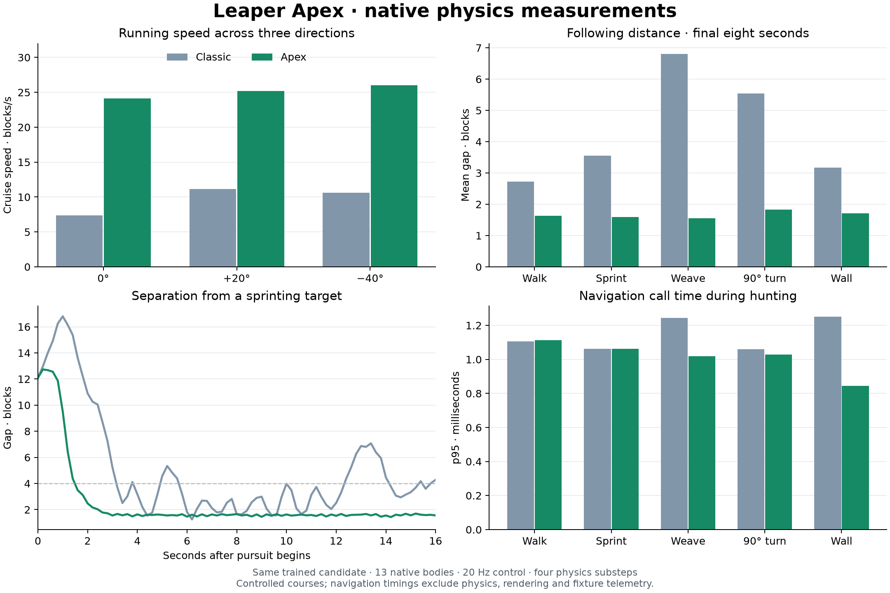

# Leaper Apex

Apex is the current gameplay controller for the physical Leaper, built around faster pursuit, controlled braking and terrain-aware assistance. It keeps the trained gait and native 13-body assembly, then adds bounded traction, suspension and steering. Classic comparisons below are historical development evidence; the current command tree only accepts Apex.

## Play

Run `tools/run-client.sh --preview` or, on macOS, double-click [Run Leaper Apex](../tools/Run%20Leaper%20Apex.command), select a disposable world, and use:

```text
/mm leaper spawn
/mm leaper hunt
```

The Leaper spawns at your position and elevation and starts a blue-eyed patrol. Give the full physical stance room to settle. Apex is always enabled, including for existing rigs; `/mm leaper version apex` remains accepted and the retired Classic command is rejected. `/mm leaper stop` and Shift-right-click with the targeting stick pause pursuit and autonomous behaviour. Block targeting requests a manual destination. `/mm leaper status` displays the active controller. A committed attack continues through Stop; see [the concussive attack](leaper-shockwave.md).

Horrific and Super Horrific enable Apex's full running speed. Explicit Careful and Standard paces retain lower speed ceilings. The preview launcher prepares versioned candidate/settings when missing and enables high-step, agile movement and leaps. Existing local experimental candidates are preserved. Ordinary packaged mode loads an earlier controller baseline; use the preview workflow for current development behaviour.

## Movement

- **Traction:** a route-directed acceleration controller targets 27 blocks/s on clear ground. Per-tick horizontal corrections are bounded to 2.1 blocks/s during acceleration and 2.7 during braking. Every body receives its mass-weighted share through native impulses.
- **Stopping and turns:** speed falls with stopping distance, heading error and terrain clearance. Moving-prey feedback uses the observed player separation and closing speed. A finite yaw spring follows a heading target that advances at most 0.08 radians per tick, after the initial settling period.
- **Gait:** cadence follows requested and measured speed. Artificial foot anchoring reduces during clear-ground running; native pad friction stays active. Standing and rough terrain retain stronger anchoring.
- **Suspension:** nearby terrain controls a damped body-height target. Ahead-of-body probes slow travel while lifting over steps. Upward assistance requires headroom, and distant ground cannot suspend the body. Vertical velocity corrections are bounded to -2.7/+1.25 blocks/s per tick.
- **Partial footing:** two steady contact samples from any one foot can authorize preparation and takeoff. A 100 ms grace period bridges brief contact loss; unsafe motion and takeoff clear it. Suspension can use the supporting feet when the torso straddles a hole. A single usable foot can grip during landing recovery.
- **Launch stance:** Apex preserves its terrain-adapted support pose while preparing the impulse. A forced deep crouch previously caused repeated launch rejection at a shoreline; see the [live loop diagnosis and replay](leaper-loop.md).
- **Leaps:** walking retains priority where a supported route exists; gaps, significant elevation changes, long travel and recovery can require checked arcs. Apex now prefers trajectories near 70°, considering arcs of at least 55° before lower collision-clear fallbacks. Ground assistance disengages during committed flight and landing recovery. Bounded yaw steering remains active during jump preparation, flight and landing, including when no walking route exists; in flight it holds the planned landing orientation. Elevated moving targets keep the existing queued retargeting behavior.
- **Navigation:** speed-dependent lookahead covers reaction and braking distance. Local corridor checks run every four ticks; long searches remain resumable with a soft five-millisecond work budget. The collision sweep uses Minecraft's live world-surface heightmap to skip empty cells above terrain. Insert/remove checks cover trunks, foliage, thin bars, raised slabs, roofs and wet footholds. A grounded stall can trigger pounce recovery before the existing five-second backout.

The assistance changes forces and finite motor targets, without teleporting the body or assigning its velocity directly. Gravity, body masses, collision geometry, joint limits and the existing sprint motor envelope are retained. This version is an engineered controller improvement; it does not claim a newly trained neural policy.

## Recorded development verification

The measurements in this section describe September 2026 source snapshots,
including the earlier selectable Classic version. They are preserved for
comparison and do not certify the current checkout. For current commands and
stateful verification, use [CONTRIBUTING.md](../CONTRIBUTING.md) and the
[behaviour guide](leaper-behaviour.md).

The later [departure-envelope and arrival-handoff fix](leaper-departure.md) addresses the separate live “Finding a way” stall. It permits departure from existing leg contacts and recognizes supported arrival even when the walking graph cannot represent the landing stance.

The subsequent [shoreline launch fix](leaper-loop.md) passed **181 unit tests and 67 native checks**, including a replay initialized from the failing live rig and terrain. It also resolved the loop in the open game without a restart.

The partial-footing update passed **181 unit tests and 66 native checks** on source `bdaa6930346a4dc0e3498705c98b98f9673035b05ec2be463b1aeb0c5f7c8c7d`. [Recorded verification summary](evidence/leaper-apex/verification-20260914-152138/summary.json), development JAR (local output: `artifacts/leaper-apex/MinecraftMachines-Leaper-Apex-Robustness.jar`; [build current source](../README.md#build-and-play)), [build manifest](evidence/leaper-apex/robustness-build-manifest.json) and source snapshot (local output: `artifacts/leaper-apex/robustness-source.zip`; [build current source](../README.md#build-and-play)) preserve this historical build. The current launcher loads the current source and preview inputs.

Four new native cases remove real terrain beneath the settled rig. With one, two or three support quadrants retained, it turns toward a diagonal destination, launches with respectively **one, one and two supported feet**, lands and settles within 1.72 blocks of the target. Each course records at least twelve partial-support samples before takeoff; joint limits, assembly integrity and uprightness remain within the fixture gates. Removing all four quadrants produces freefall with zero launches. These are toe-to-surface proximity estimates, not contact-force measurements. Existing hunting, follow/stop, destination, leap-command, walking-stair, elevation and collision checks all pass. The repeated paired speed test retains 25.13 blocks/s Apex cruise versus 9.72 Classic.

The initial Apex verification (before the partial-footing update) passed **178 unit tests and 62 native checks**: 49 movement trials (including three Classic comparison runs) and 13 collision-sensing checks. The six walking-only flat/stair routes completed with leaps disabled. Twelve elevation courses covered straight and diagonal approaches to 4/8/12-block climbs and 4/8/16-block descents. The gap and command tests exercised eight-block gaps, cancellation during crouch, valid and invalid airborne retargeting, stop/resume, obstacle insertion/removal and landing cooldowns. Apex's phase-command fixtures used real gaps for unobstructed flat routes; the original event and physical assertions remained active.

| Same 110-block course, three headings | Classic | Apex |
| --- | ---: | ---: |
| Mean cruise speed, blocks 20–80 | 9.72 blocks/s | **25.13 blocks/s** |
| Mean time to enter destination range | 15.75 s | **5.12 s** |
| Mean vertical body range during cruise | 2.01 blocks | **1.64 blocks** |

That is **2.58× cruise speed**, 68% less arrival time and 18% less vertical body variation. All six runs settled near the destination and used zero committed leaps, so the speed comparison measures running. The sustained Apex chases averaged 1.63 blocks behind walking prey, 1.59 behind sprinting prey, 1.55 during weaving, 1.83 through a right-angle escape and 1.71 through a wall detour. During the final eight seconds, each case registered supported capture range on 160–161 of 161 samples. Support here means native toe-to-surface proximity, not a force-sensor measurement.

Hunting navigation calls measured 0.84–1.11 ms p95, with a 17.37 ms worst sample. The high-speed straight-course p95 was 1.28 ms for Apex versus 0.43 ms for Classic: the longer, more frequent lookahead costs additional work per call. These timings exclude physics integration, rendering and fixture telemetry. JVM warmup and occasional long calls remain visible in the raw reports; the five-millisecond planning budget is soft.

Source fingerprint: `265683e5f65903e98ddfba52af810915b5a26c29c2cff71fb86fc3413ad0191d`. Final Apex reports: [verification summary](evidence/leaper-apex/verification-20260914-124359/summary.json). The development JAR (local output: `artifacts/leaper-apex/MinecraftMachines-Leaper-Apex-Development.jar`; [build current source](../README.md#build-and-play)), [build manifest](evidence/leaper-apex/build-manifest.json) and exact preview inputs are retained alongside them. The JAR requires this project's normal dependencies; the launcher supplies the tested preview settings.

The same source also passed all **31 Classic regression cases**, giving **93 native checks** across both verification runs. [Classic summary](evidence/leaper-hunting/verification-20260914-124750/summary.json) and [comparison data](evidence/leaper-apex/comparison.json) retain the results. The shared empty-air collision optimization benefits both versions; increased lookahead remains an Apex-specific cost.



Regenerate this figure with a Python environment containing Matplotlib:

```sh
python tools/report_leaper_apex.py \
  artifacts/leaper-apex/verification-20260914-124359 \
  artifacts/leaper-hunting/verification-20260914-124750
```

The recorded paired speed fixture compared Classic and Apex on the same 110-block destination at three headings. Cruise was measured over blocks 20–80, and success also required sustained grounded settling near the destination with the existing joint and stability guards. Its historical qualification gate required at least twice Classic's mean cruise speed across all three pairs. Raw trajectories, development failures and verification reports remain local under `artifacts/leaper-apex/`.

## Verify the current source

Run `python3 tools/verify_leaper_hunting.py --apex --full`. It builds the development JAR, runs the common unit tests, then exercises sustained hunting, follow/stop, destination arrival, pounce commands, walking-only stairs, speed, elevation, collision sensing, partial-support takeoff/freefall and the captured shoreline/departure regressions. Native simulation uses Sable/Rapier at 20 Hz with four substeps in a disposable scratch world. The runner checks report freshness, source fingerprints and every trial's outcome, including older harnesses that can exit successfully despite failed trials.

The [13 October 2026 sustained hunting report](evidence/leaper-hunting-20261013.json) records five current hunting regressions. It does not represent a fresh run of every historical comparison above.

These controlled courses establish their measured scope. Dense forests, narrow passages, water, unloaded destinations and untested terrain combinations still need field testing. Current gameplay also includes the [concussive attack](leaper-shockwave.md), which was added after the initial movement comparison.
