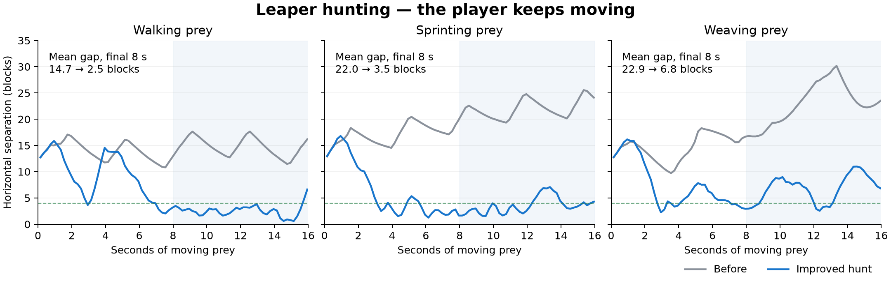

# Leaper hunting — September 2026

> Development record. Measurements, source hashes and historical commands below describe the recorded implementation. They are not fresh verification or a supported release. See the [documentation index](index.md) for current guides. Unlinked `artifacts/` and `release/` paths refer to local output omitted from this repository.

Gameplay now uses [awareness and behaviour](leaper-behaviour.md): blue patrol, orange investigation, and red confirmed hunting. Live pursuit receives only visible evidence and gives up into a bounded last-seen search. The measurements below exercise the existing locomotion controller with continuously supplied prey observations; they are separate from the new perception and memory tests.

## Walking, jumping and clearing traps — September 15 update

Walking is the default for nearby and medium-distance targets. Automatic jumps are reserved for travel of at least 32 blocks, changes in surface height of at least three blocks, or detected gaps and ledges. Small steps remain part of the walking gait. After landing, the Leaper spends at least five seconds walking before another automatic jump; moving-target updates cannot reset that interval. Failed ground planning or a brief stall alone no longer starts a jump.

If it makes little progress for about three seconds while trying to travel and solid blocks obstruct it nearby, it charges a [clearing pulse](leaper-shockwave.md), then replans through the changed terrain. The pulse retains its five-block TNT-style destruction, drops and resistance rules. It can trigger without a nearby player and respects the normal attack cooldown. Idle and airborne Leapers do not accumulate a trapped state.

The measurements below describe the earlier hunting update; the traversal verification record (local evidence: `artifacts/leaper-traversal/IMPLEMENTATION.md`) documents that development snapshot. Current instructions are in [controls](leaper-controls.md) and [behaviour](leaper-behaviour.md).

Hunting now tracks a moving player at five observations per second, leads their motion, and uses the existing physical sprint gait on suitable ground. Stops and direction reversals immediately change the prediction; teleports do not become extreme velocity estimates. Prediction is limited to one second and six blocks, and every requested destination still requires dry support.

The previous controller refreshed no more than once per second and after three blocks of displacement. It also treated distant prey as an automatic reason to stop and plan another pounce, even on open ground. Its default Horrific gait could fall behind sustained player movement. In the new controller, Horrific hunting enables the existing Super Horrific actuator profile, while explicitly selected Careful and Standard retain their pace. The original trained genome, masses, gravity, joint limits and physics substeps are retained.

The route planner checks a direct corridor one voxel at a time before expanding A*. This uses the same stance, body, surface-layer and risk checks; an obstruction or difficult terrain falls back to the graph. A unit test verifies over a twofold reduction in body queries on a 96-block flat corridor. Planning remains on the server thread with resumable work and a soft five-millisecond budget. Individual terrain operations, garbage collection and JVM warmup can exceed that budget.

Routes refresh in the background as prey moves. The controller reconnects to the nearest validated segment from the current body position instead of returning toward the old search origin. Moving prey does not activate the stationary arrival hold or final-point braking. Closing-speed feedback reduces overshoot. Elevated targets, blocked ground routes and stalls retain the pounce machinery; committed airborne trajectories remain intact and receive a queued destination for landing.

## Native evidence

The sustained hunting fixture drives the real 13-body, 87-mass Leaper in Sable/Rapier at 20 Hz and four physics substeps. Synthetic prey coordinates remain in motion throughout each 16-second chase. Both comparison arms receive the same four-tick observations, so the comparison measures controller changes independently of the manager's faster sampling. The recorded baseline never reached grounded capture range in its three cases.

| Moving prey | Previous mean gap | Improved mean gap | Reduction |
| --- | ---: | ---: | ---: |
| Walking, 4.3 blocks/s | 14.71 blocks | 2.53 blocks | 83% |
| Sprinting, 5.6 blocks/s | 22.03 blocks | 3.55 blocks | 84% |
| Weaving | 22.91 blocks | 6.80 blocks | 70% |

Means cover seconds 8–16, after initial acceleration. The additional right-angle and wall-detour cases average 5.54 and 3.17 blocks. All five reach grounded capture range while the target remains in motion. These runs measured 2.03–2.55 ms p95 for the complete navigation call, with a 7.56 ms maximum. Maximum joint-anchor separation was 0.076 blocks; no measured joint-limit violations occurred. This is controller latency, excluding fixture setup and telemetry, not whole-server frame time.



Final controller fingerprint: `d4bbe1671ec2ba6ced20057fa29a2054a7f11efef67992bbc4ce630d7399fd0e`. Raw final reports are in `artifacts/leaper-hunting/verification-20260914-110039/`; `comparison.json` records the matched measurements. Capture remains intermittent during running strides; the improved walking case ends 7.01 blocks from the still-moving target despite its 2.53-block mean. This is improved pursuit, not a claim of constant contact with every evasive player.

The full verification passed **174 unit tests and 31 native cases**: five sustained hunts, three follow/stop/elevated-prey checks, nine destination/arrival/backoff checks, eight pounce-command checks and six walking-only flat/stair routes. The development JAR builds successfully. The launcher candidate and high-step settings match the verified fixture inputs byte for byte.

Reports are retained under `artifacts/leaper-hunting/`, including raw trajectories, failures and implementation fingerprints. The five candidate cases cover walking, sprinting, weaving, a right-angle escape and a wall detour. Success requires at least ten supported samples within four blocks of moving prey during the second half, mean and final separation at most eight blocks, p95 navigation time at most ten milliseconds, and the existing physical guards. The baseline mode records failures without failing Gradle; candidate mode fails Gradle when a chase fails.

These are development measurements with the existing base26 candidate/settings, not a universal terrain qualification or a newly trained neural policy. Grounded capture uses toe proximity to collision surfaces rather than contact-force measurements. The hunting mode approaches the player; these changes do not add combat damage.

## Run and reproduce

On this checkout, double-click `tools/Run Leaper Hunt.command`, choose a world with room for the Leaper, then use `/mm leaper spawn` and `/mm leaper hunt`. `/mm leaper stop` or Shift-right-click with the targeting stick stops it. The launcher selects the same preview settings used by the native checks and leaves world selection to you.

With Java 21 configured:

```sh
./gradlew :minecraft_machines:common:test :minecraft_machines:neoforge:runGameTest \
  -PgameTestNamespaces=minecraft_machines_quadruped_leaper_learning \
  -PleaperScratch=true -PleaperMode=predator-hunting-regression \
  -PleaperProfile=horrific -PleaperHighStepCandidate=true \
  -PleaperAgile=true -PleaperLeap=true
```

`python3 tools/verify_leaper_hunting.py --full` runs the unit tests, builds the JAR, and checks all five native suites (31 cases), including walking-only stairs. It saves timestamped logs and reports, checks their source fingerprints and rejects unsuccessful trials even when an older harness exits successfully. Without `--full`, it runs the build and five sustained hunts only.

This rebuilds only the disposable scratch GameTest world. For existing regression suites, substitute `predator-follow-regression`, `predator-pursuit-regression-candidate`, or `predator-pounce-commands` for the mode. Their detailed JSON reports also need inspection: the older development harnesses can report a failed trial even when Gradle succeeds.
